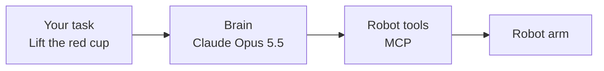
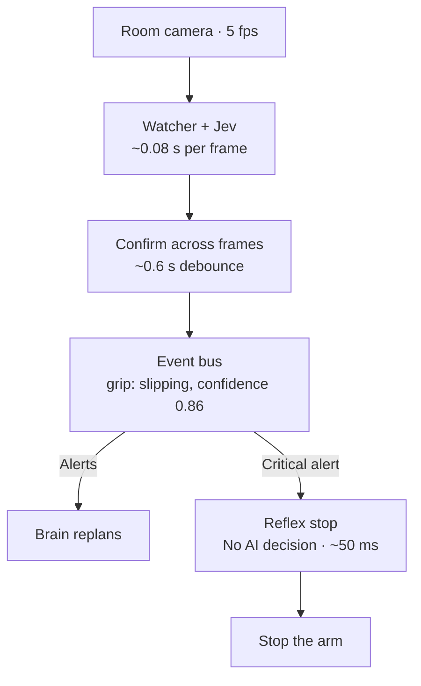
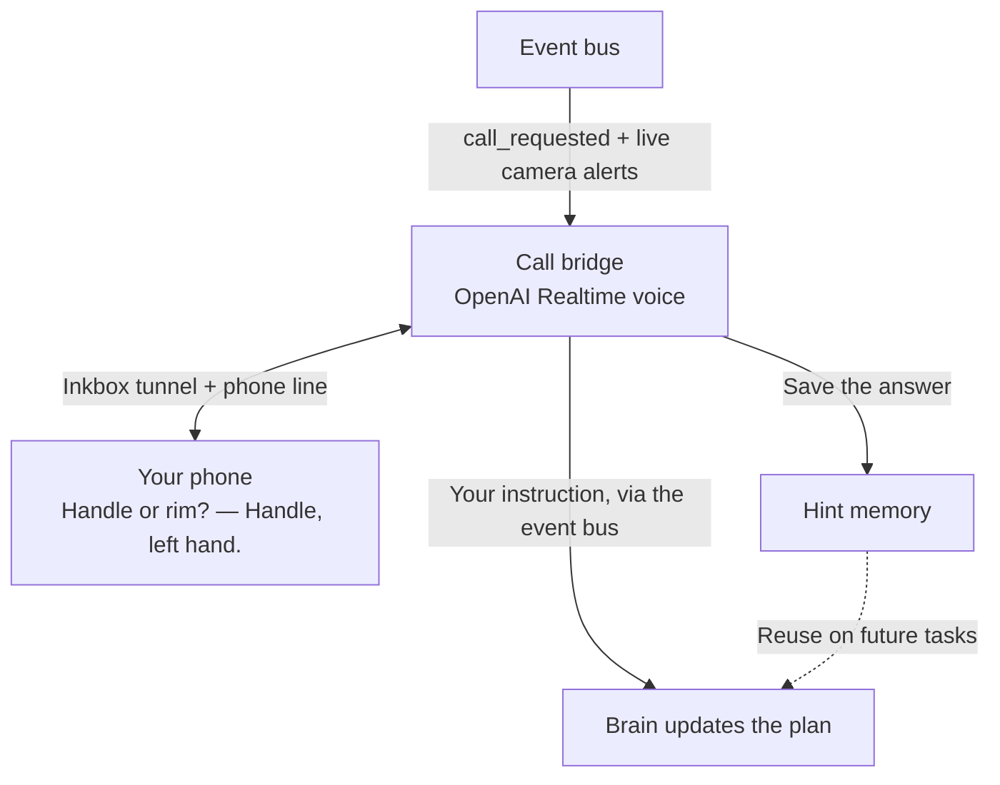

# HACKATHON2026: Waldo

**Waldo gives an AI agent eyes that react in a tenth of a second, a phone number to call you when it's unsure,
and a memory so it needs you less each time.**

Waldo is a lab workstation driving robot hardware: WidowX AI arms (Trossen) and a Unitree G1 humanoid. This repo
lets a Claude agent run physical tasks like "lift the red cup", notice within about a second when something goes
wrong, stop, phone the operator, talk it through live while the cameras keep watching, and remember the answer.

## The flow

Waldo runs three connected loops on the lab PC: act, watch, and ask for help.

**1. Act on the task**



The brain plans each step and tells the watcher what to check with `set_step`.

**2. Watch the task and stop on critical alerts**



**3. Ask for help and remember the answer**



During the call, the voice agent can check status, consult the brain, pass instructions, stop the robot, or hang up. Camera alerts keep arriving while you talk.

| t | What happens |
|---|---|
| 0 s | The cup slips |
| 0.6 s | Jev flags it 3 frames in a row → alert |
| 1 s | Arm stopped |
| ~5 s | Your phone rings |
| — | You answer; the call keeps reacting to the camera |
| ~10 s after you answer | Claude has a new plan and reads it back; you say "go" |
| next time | The hint solves it with no call |

## Why this is built for agents

All of this exists so **an AI agent can do physical work without a person watching it**. A human operator wouldn't
need most of it.

1. **Agents are slow and can't watch.** Claude takes seconds per decision and can't look at video 5 times a second.
   Jev is a fast, cheap "eye" that turns video into a few typed events, so the agent only wakes up when something
   actually changes.
2. **The agent can tell when it's unsure.** Jev returns probabilities ("slipping, 0.86"), which gives the agent a
   measurable "I'm confused" signal instead of finding out after failing several times.
3. **Asking a human is a tool the agent calls.** `call_operator` / `ask_human` replace constant supervision. Inkbox gives
   the agent its own identity (phone line, email, iMessage), so it reaches you the way a coworker would.
4. **The conversation is live on both ends.** The voice agent is connected to the robot's sensors and tells you what's
   happening as it happens. Your words go straight back to the planning agent, while the robot stays stopped.
5. **Every human answer makes the agent more independent.** Answers become hints with a success score; advice that
   worked is reused automatically. The metric that matters is how rarely it needs you.
6. **It plugs into any agent.** Robot, camera checks and the human channel are tools (MCP servers and a local event
   bus). Our brain uses them today; Claude Code, Hermes or another agent could use the same tools.
7. **The safety layers don't depend on the AI.** The reflex stop, the robot tools' limits and the hand controller don't
   rely on any model being right.

## What's in the repo

| Folder | What it does |
|--------|--------------|
| [`waldo-live/`](waldo-live/) | The live loop: event bus, Jev watcher, Inkbox ⇄ OpenAI Realtime call bridge (help, command and dance calls), beat tracker, phone camera page, Claude brain, clip recorder |
| [`waldo-mirror/`](waldo-mirror/) | The G1's arms: live mirroring from a phone camera, the dance engine (freestyle on the beat + Just Dance routines), choreography worker |
| [`waldo-ask/`](waldo-ask/) | MCP server for asking the operator by email, iMessage, SMS or phone, with the hint memory |
| [`waldo-mcp/`](waldo-mcp/) | MCP server for the G1 humanoid over the Unitree SDK: stand, gestures, stop, cameras (no walking) |
| [`waldo-arms/`](waldo-arms/) | **MCP server for the G1's hands and grippers** through `arm_server` (IK, collision and table checks): `move_hand`, `gripper`, `check_reach`, `look`, … |
| [`waldo-sim/`](waldo-sim/) | **MuJoCo desk-sorting sim on Unitree's G1 + Dex1-1 model**, speaking the real robot's protocols so `waldo-arms`, agents and VLMs run unchanged; `planner.py` (works on the real arm_server too) and `bench_sort.py` (sort rate on ground truth) |
| [`waldo-console/`](waldo-console/) | Laptop-side G1 controls: browser console, virtual XR controllers for teleop (legacy manual mode), a second MCP (speech, LED, volume, session queue), arm_server client |
| [`waldo-call/`](waldo-call/) | One-shot test call through Inkbox's hosted voice agent |
| [`docs/quickstart.md`](docs/quickstart.md) | **Start here:** access, cameras, robot modes, and how to run every piece |
| [`docs/vlm-hand-tasks.md`](docs/vlm-hand-tasks.md) | **VLM-driven hand tasks:** onboard models → `point_to_xyz` → `move_hand`; integration recipes, precision, measured numbers |
| [`docs/g1-arm-commands.md`](docs/g1-arm-commands.md) | Every `arm_server` command, FSM modes, the teleop controller map, stop procedures |
| [`docs/live-call-framework.md`](docs/live-call-framework.md) | Detailed design: components, event schema, timings, security |
| [`docs/recording-guide.md`](docs/recording-guide.md) | Shot list for recording labeled clips to tune Jev |
| [`docs/robot-survey.md`](docs/robot-survey.md) | What's on Waldo: hardware, network, existing control code, safety rules |

## Running it

Everything runs on Waldo. Connection details are private: the `.example` hostnames and `operator` account below are placeholders. Obtain the real values from the lab administrator. From your Mac:

```sh
ssh -t operator@lab-pc.example '~/HACKATHON2026/waldo-live/start.sh'      # bus, watcher, bridge, brain in one tmux window
ssh operator@lab-pc.example 'cd ~/HACKATHON2026/waldo-live && ./run.sh brain task "lift the red cup"'
ssh operator@lab-pc.example '~/HACKATHON2026/waldo-live/stop.sh'
```

In tmux: click a pane to focus it, **Ctrl-b then d** to leave everything running. Details are in [`waldo-live/README.md`](waldo-live/README.md).

From your phone, text Waldo's iMessage line (where you sent `connect @waldo-agent`):

| Text | What happens |
|------|--------------|
| `call me` | Waldo calls; say commands from the menu ("status", "wave"...). Motion needs your "yes" |
| `dance` | Waldo calls, asks for a song and dances to it. Text the song name for the Just Dance routine. Say or text "stop" to stop |

Arm mirroring and the dance engine: [`waldo-mirror/README.md`](waldo-mirror/README.md).

## Status (2026-10-17)

| Piece | State |
|-------|-------|
| Jev watcher | ✅ Live on the room webcam: 5 fps, 0.07–0.12 s per frame. Grip check needs tuning on recorded clips |
| Event bus, start/stop scripts | ✅ Running on Waldo |
| Call bridge | ✅ Built, tested with fakes; private Inkbox tunnel active (endpoint omitted), signing key set |
| Phone calls | ✅ Test call to the operator worked (Inkbox shared iMessage line, transcript read back) |
| **Phone commands (MVP)** | ✅ **Text "call me" → Waldo calls → "wave" → "Go ahead?" → "Yes" → the G1 waves** (~1 s from yes to motion) |
| **Arm mirroring** | ✅ Live on the G1: phone camera → MediaPipe → Unitree IK → arms, at 0.8 rad/s with comfort limits and a clean release |
| **Dance calls** | ✅ Live on the G1: text "dance" → Waldo calls → plays your song → "I can feel that song in my joints! 3, 2, 1" → dances until the song ends |
| **Just Dance routines** | ✅ Text the song name during a dance → routine found on YouTube, converted with MediaPipe in ~100 s (Levitating cached), synced to the call audio |
| Brain | ✅ Built, tested with a fake model; runs on Waldo |
| Tests | ✅ 12 (`waldo-ask`) + 58 (`waldo-live`) + 46 (`waldo-mirror`) passing on Waldo |

**Still needed:**

- [x] OpenAI credits for the phone voice
- [ ] Anthropic API key with credits ($10–20) for the brain
- [ ] From the bay owner: the `widowx` MCP server command, a safe arm-stop command, and an OK to use the robot
- [ ] Recorded clips of good and failed grasps ([guide](docs/recording-guide.md)) to tune the watcher

Keys live only on Waldo in `~/.waldo-ask/env` (mode 600). Never commit them: this repo is public.

## Connecting to Waldo

The actual SSH address, account, tailnet device name, and tunnel URL are intentionally omitted. Configure your own deployment using the placeholders below.

1. Install [Tailscale](https://tailscale.com/download), sign in, and accept the invite for the machine `lab-pc`.
2. Open an SSH session that also forwards the camera stream:

   ```sh
   ssh -L 8766:camera.example:8766 operator@lab-pc.example
   ```

   Use credentials provided privately by the lab administrator.
3. While that session is open, go to <http://localhost:8766/> to see the head camera and the room webcam.

Closing the SSH session also cuts off the camera stream. If you can't connect, check that Tailscale says
**Connected** and that `lab-pc` is in its machine list.

## Safety

- Someone holds the hand controller or stays within reach of the arms' stop during every run.
- No walking on the G1 (site rule). The G1 server has no walking tool; mirroring and dancing move only the arms and a little waist sway.
- Arm motion (mirroring, dancing) runs only with the robot balancing, on the gantry, with a spotter on the controller (L1+A).
- "Person within reach" shots and tests happen only with the arm parked or its motors off.
- Waldo is shared: check with the bay owner before using the robot.

## G1 agent stack (humanoid arms as agent skills)

Agents running physical work cells on the Unitree G1 through MCP: machine tending + QC, a hardware-in-the-loop
firmware update, overpressure interlocks, receipts. Claude ran both cells from plain-English work orders and matched
ground truth. One-command demos and numbers: [docs/g1-agent-stack.md](docs/g1-agent-stack.md).
