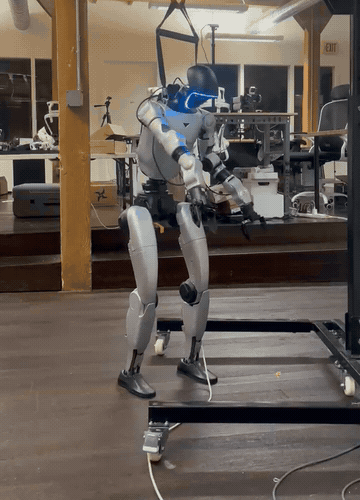
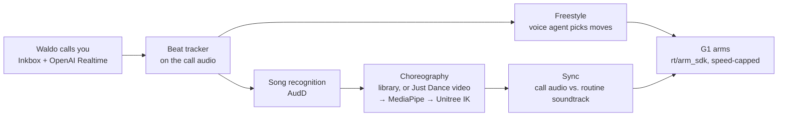
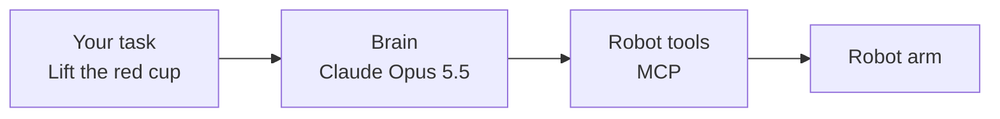
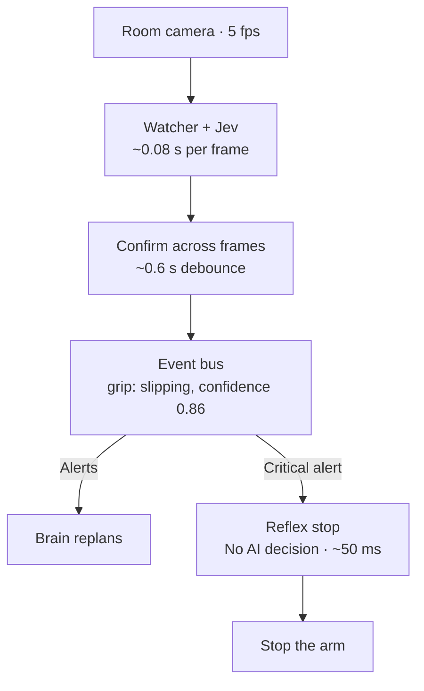
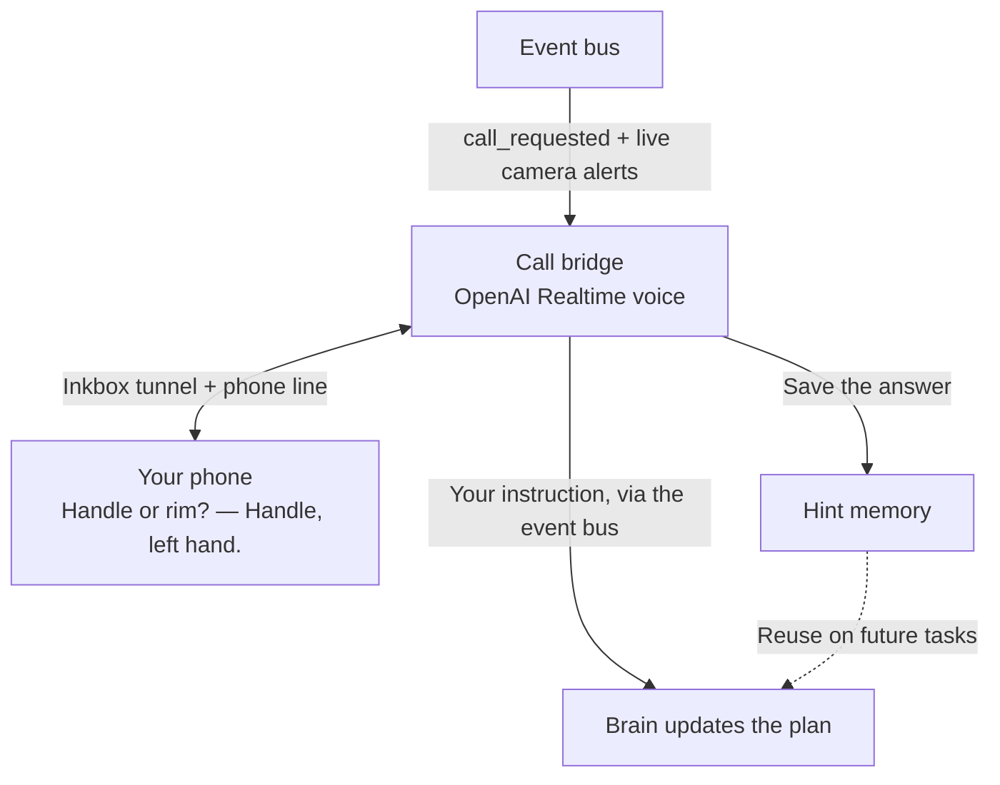
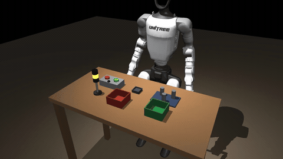
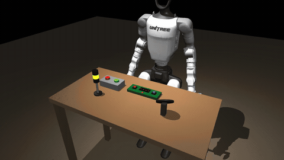
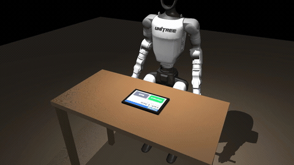
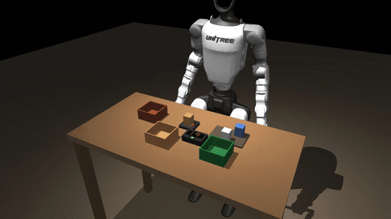

<!-- YC logo source: https://www.ycombinator.com/press -->
[](https://events.ycombinator.com/MakeSomethingAgentsWant)

# HACKATHON2026: Waldo

Built for [Make Something Agents Want](https://events.ycombinator.com/MakeSomethingAgentsWant),
a hackathon hosted by YC teams in San Francisco on **October 17–18, 2026**. The challenge: build
products with AI agents as their users, from MCP tools to communication infrastructure.

Agents already work well in software. Our thesis is that they should also be able to **take in what's happening
around them, decide what to do about it, and act through robots that already exist.** Waldo is our attempt at
that: an agent connected to a phone line, to cameras and audio, and to a real Unitree G1 humanoid. We didn't build
the robot or its motion control. We built the connections that let an agent use them.

> **Live from [Mission Robotics](https://missionrobotics.ai/), San Francisco.** We accessed the [Unitree G1](https://www.unitree.com/g1/) remotely through
> tailscale and watched a live video stream from the lab while operating the robot.

<!-- Official Inkbox mark and wordmark: https://inkbox.ai/ -->
<table>
  <tr>
    <td align="center" valign="middle" width="220">
      <a href="https://inkbox.ai/"></a><br>
      <strong>Waldo’s phone connection</strong>
    </td>
    <td align="center" valign="middle" width="140">
      <strong>Calls + iMessage</strong><br>
      <br>
      Ask for help.<br>Receive instructions.
    </td>
    <td align="center" valign="middle" width="280">
      <br>
      <strong>Waldo · Unitree G1</strong>
    </td>
  </tr>
</table>

## What Waldo does

Four capabilities, which share one event bus on the lab PC rather than running as four separate programs:

| Capability | What exists | In the dance demo |
|---|---|---|
| **Communicate** | Waldo has its own phone line and iMessage through [Inkbox](https://inkbox.ai/); an OpenAI Realtime voice agent talks on the calls | Waldo calls you and asks you to play a song |
| **Perceive** | Call audio (beat tracking, song recognition), the room webcam, the G1's head camera, a phone camera; a Jev-based watcher turns camera frames into typed events | Listens to the music on the call |
| **Decide** | The voice agent chooses what to say and, while freestyling, which moves to dance. Deterministic code chooses when to start, which routine to play, and where in the song it is | Picks dance moves; finds and syncs the song's choreography |
| **Act** | Arm motion through the Unitree SDK (`rt/arm_sdk`) with speed caps and comfort limits; gestures, stand and stop through MCP servers | The G1 dances, arms only |

## The demo: Waldo wants to dance

The two-minute video shows the dance call on the real G1. This is what runs, traced through the code:



1. **The call.** You text `dance` to Waldo's line and Waldo calls you back (Inkbox places the call, OpenAI Realtime
   is the voice). It asks you to play a song.
2. **Listening.** A beat tracker on the lab PC follows the music in the call audio. After three steady tempo
   readings, Waldo says *"I can feel that song in my joints! Dancing in 3, 2, 1!"* and the arms start.
3. **Freestyle.** Every 32 beats the voice agent, which hears the music, picks 4 moves from 7 built-in ones
   (`pump`, `sway`, `wave`, `raise_roof`, `disco`, `circles`, `hands_up`) and an energy level. The dance engine
   turns them into joint targets on the beat, scaled down if needed to stay under the speed cap.
4. **Recognizing the song.** After about 10 s of music (8 s in the `main` version), the call audio goes to [AudD](https://audd.io/), a
   song-recognition API. Without an AudD key, Waldo asks you to text the title instead.
5. **Getting the choreography.** If the song's routine was prepared before, it's ready immediately. If not, it's
   prepared on the spot (about 100 s): the Just Dance video is found on YouTube, MediaPipe tracks the coach at
   15 fps, Unitree's arm IK converts the poses to G1 joint angles within comfort limits, and a forward pass caps
   every joint at the dance speed. If no routine can be found, Waldo keeps freestyling.
6. **Syncing.** The last 15 s of call audio are cross-correlated with the routine's own soundtrack to find the
   current position in the song; it re-checks every 30 s. Then the robot switches from freestyle to the routine.
7. **Stopping.** The dance ends when the music stops, when you say or text "stop", when the call ends, or after
   10 minutes. The arms glide back to where they started and are handed to Unitree's stock controller.

**Who decides what:**

| Decision | Made by |
|---|---|
| What Waldo says; which freestyle moves and how energetic | OpenAI Realtime voice agent (an LLM) |
| When the beat is steady enough to start; stop words | Deterministic code (beat tracker, word matching) |
| Which song is playing | AudD, or you by text |
| Which routine to use, and where in it the music is | Deterministic code (library lookup, YouTube search ranking, audio cross-correlation) |
| Joint angles | Pre-built move functions, or MediaPipe + Unitree IK. Never an LLM |
| Whether the robot may move | Safety checks in code: robot balancing (FSM 500), no other arm controller running, speed cap, time cap |

**What the demo is not:** the robot doesn't learn to dance or get better with each performance. Routines that were
prepared before are cached and reused; that's a lookup, not learning. The dance doesn't go through MCP: the dance
engine drives the arms directly through the Unitree SDK. Torso and legs stay with Unitree's balance controller.

**Checked before it runs:** we validated prepared routines offline on the G1's model: joint comfort ranges, joint
speed ≤ 1 rad/s, no hand crossing the midline, and mesh self-collision. Of 10 songs tried, 5 pass (Happy, Blinding
Lights, September, Dynamite, Vogue); [results](docs/song-routines-handoff.md). Video script:
[docs/demo-script.md](docs/demo-script.md).

The current dance code on `main` recognizes songs with AudD or a texted title. The version on the lab PC adds a
second AudD try, a fallback match against the routine library, and a Supabase routine library; that code isn't in
this repo yet.

## The hardware

| | |
|---|---|
| Robot | Unitree G1 humanoid (29 DoF), Dex1 grippers, hanging in a gantry, arms only. No walking (site rule) |
| Robot computer | The G1's onboard Jetson runs Michael's `arm_server` (IK, self-collision and table path checks, workspace guard, watchdogs) |
| Lab PC ("Waldo") | Ubuntu 24.04 workstation, 16 cores, RTX 5060, wired to the G1 (DDS over Ethernet); runs everything in this repo |
| Cameras | G1 head camera, a Logitech C920 room webcam, and optionally a phone at the robot's eye level |
| Access | Remote, through Tailscale, from the hackathon venue to Mission Robotics |
| Stop | A person holds the G1's hand controller during every run (L1+A damps the robot regardless of software) |

Details: [docs/robot-survey.md](docs/robot-survey.md), [docs/quickstart.md](docs/quickstart.md).

## Beyond the demo: watching, stopping and asking for help

The dance is the part we showed. The same lab PC also runs a larger loop for task work, built for the case where
an agent is doing something physical and it goes wrong. These pieces are built and tested individually; the full
loop (a real task failing, a call, a new plan, a retry) hasn't yet run end to end on the robot.

**1. Act on the task**



The brain plans each step and tells the watcher what to check with `set_step`. It's tested with a fake model; it
needs an Anthropic API key to run on the lab PC.

**2. Watch the task and stop on critical alerts**



The watcher runs live on the room webcam (0.07–0.12 s of Jev time per frame). The debounce and stop times are
design targets, not measured end-to-end reaction times.

**3. Ask for help and remember the answer**



During a help call, the voice agent can check status, consult the brain, pass instructions, stop the robot, or
hang up, and camera alerts keep arriving while you talk. Your answers are saved as hints with a success count, and
hints that worked are offered to the brain on later tasks. That's stored advice, not learning, and reuse is
unit-tested but not yet demonstrated on a real task.

The design timeline for one failure (targets, from [docs/live-call-framework.md](docs/live-call-framework.md)):

| t | What happens |
|---|---|
| 0 s | The cup slips |
| 0.6 s | Jev flags it 3 frames in a row → alert |
| 1 s | Arm stopped |
| ~5 s | Your phone rings |
| — | You answer; the call keeps reacting to the camera |
| ~10 s after you answer | Claude has a new plan and reads it back; you say "go" |
| next time | The hint solves it with no call |

## Why this is built for agents

All of this exists so **an AI agent can do physical work without a person watching it**. A human operator wouldn't
need most of it.

1. **Agents are slow and can't watch.** Claude takes seconds per decision and can't look at video 5 times a second.
   Jev is a fast, cheap "eye" that turns video into a few typed events, so the agent only wakes up when something
   actually changes.
2. **The agent can tell when it's unsure.** Jev returns probabilities ("slipping, 0.86"), which gives the agent a
   measurable "I'm confused" signal instead of finding out after failing several times.
3. **Asking a human is a tool the agent calls.** `call_operator` / `ask_human` replace constant supervision. Inkbox gives
   the agent its own identity (phone line, email, iMessage), so it reaches you the way a coworker would.
4. **The conversation is live on both ends.** The voice agent is connected to the robot's sensors and tells you what's
   happening as it happens. Your words go straight back to the planning agent, while the robot stays stopped.
5. **Human answers are kept.** Answers become hints with a success score, and advice that worked is offered first
   next time. The goal is an agent that needs you less often; we haven't measured that yet.
6. **It plugs into any agent.** Robot, camera checks and the human channel are tools (MCP servers and a local event
   bus). Our brain uses them today; Claude Code, Hermes or another agent could use the same tools.
7. **The safety layers don't depend on the AI.** The reflex stop, the robot tools' limits and the hand controller don't
   rely on any model being right.

## In simulation: agents running work cells

We also explored what an agent could do with the G1's arms beyond dancing, in a MuJoCo model of the G1 + Dex1
that speaks the real robot's `arm_server` protocol. **These ran in simulation only**: the stations haven't been
taught on the real robot yet. Claude drove them through MCP from plain-English work orders; details and numbers in
[docs/g1-agent-stack.md](docs/g1-agent-stack.md).

Quick loops from the recorded MuJoCo runs, with room and head-camera views plus captions from the agent’s reasoning
and tool calls. Click a GIF for the full demo highlights.

<table>
  <tr>
    <td align="center" width="50%">
      <strong>Machine tending</strong><br>
      <a href="media/g1-demos/cell_highlights.mp4"></a><br>
      Load a part into the machine · 5× speed
    </td>
    <td align="center" width="50%">
      <strong>Two-hand board recovery</strong><br>
      <a href="media/g1-demos/lab_highlights.mp4"></a><br>
      Hold BOOT, press RESET · 6× speed
    </td>
  </tr>
  <tr>
    <td align="center" width="50%">
      <strong>Tablet app testing</strong><br>
      <a href="media/g1-demos/qa_highlights.mp4"></a><br>
      Tap through checkout with a fingertip · 4× speed
    </td>
    <td align="center" width="50%">
      <strong>Warehouse returns</strong><br>
      <a href="media/g1-demos/returns_highlights.mp4"></a><br>
      Move the scanned item to restock · 6× speed
    </td>
  </tr>
</table>

**[Watch all six examples — 2:02 highlights reel](media/g1-demos/all_highlights.mp4)**

| Simulation example | Highlights (MP4) | Full run, 3x speed (MP4) |
|---|---|---|
| Machine tending + quality control | [Watch 0:23](media/g1-demos/cell_highlights.mp4) | [Watch 1:36](media/g1-demos/cell_full.mp4) |
| Firmware recovery + pressure interlock | [Watch 0:21](media/g1-demos/lab_highlights.mp4) | [Watch 0:46](media/g1-demos/lab_full.mp4) |
| Router troubleshooting | [Watch 0:08](media/g1-demos/it_highlights.mp4) | [Watch 0:22](media/g1-demos/it_full.mp4) |
| Datacenter drive recovery | [Watch 0:08](media/g1-demos/rack_highlights.mp4) | [Watch 0:22](media/g1-demos/rack_full.mp4) |
| Tablet checkout testing | [Watch 0:23](media/g1-demos/qa_highlights.mp4) | [Watch 0:47](media/g1-demos/qa_full.mp4) |
| Warehouse returns sorting | [Watch 0:31](media/g1-demos/returns_highlights.mp4) | [Watch 1:09](media/g1-demos/returns_full.mp4) |

[Browse all recordings and uncut camera footage](media/g1-demos/README.md) · [Run the simulations yourself](docs/g1-agent-stack.md#demos-one-command-each-in-the-sim)

## What's in the repo

| Folder | What it does |
|--------|--------------|
| [`waldo-live/`](waldo-live/) | The live loop: event bus, Jev watcher, Inkbox ⇄ OpenAI Realtime call bridge (help, command and dance calls), beat tracker, phone camera page, Claude brain, clip recorder |
| [`waldo-mirror/`](waldo-mirror/) | The G1's arms: live mirroring from a phone camera, the dance engine (freestyle on the beat + Just Dance routines), choreography worker |
| [`waldo-ask/`](waldo-ask/) | MCP server for asking the operator by email, iMessage, SMS or phone, with the hint memory |
| [`waldo-mcp/`](waldo-mcp/) | MCP server for the G1 humanoid over the Unitree SDK: stand, gestures, stop, cameras (no walking) |
| [`waldo-arms/`](waldo-arms/) | **MCP server for the G1's hands and grippers** through `arm_server` (IK, collision and table checks): `move_hand`, `gripper`, `check_reach`, `look`, … |
| [`waldo-sim/`](waldo-sim/) | **MuJoCo desk-sorting sim on Unitree's G1 + Dex1-1 model**, speaking the real robot's protocols so `waldo-arms`, agents and VLMs run unchanged; `planner.py` (works on the real arm_server too) and `bench_sort.py` (sort rate on ground truth) |
| [`waldo-console/`](waldo-console/) | Laptop-side G1 controls: browser console, virtual XR controllers for teleop (legacy manual mode), a second MCP (speech, LED, volume, session queue), arm_server client |
| [`waldo-call/`](waldo-call/) | One-shot test call through Inkbox's hosted voice agent |
| [`docs/quickstart.md`](docs/quickstart.md) | **Start here:** access, cameras, robot modes, and how to run every piece |
| [`docs/demo-script.md`](docs/demo-script.md) | The demo video script |
| [`docs/song-routines-handoff.md`](docs/song-routines-handoff.md) | Just Dance routine checks for 10 songs (limits, crossing, self-collision, tracking, sync) and the top picks |
| [`docs/vlm-hand-tasks.md`](docs/vlm-hand-tasks.md) | **VLM-driven hand tasks:** onboard models → `point_to_xyz` → `move_hand`; integration recipes, precision, measured numbers |
| [`docs/g1-arm-commands.md`](docs/g1-arm-commands.md) | Every `arm_server` command, FSM modes, the teleop controller map, stop procedures |
| [`docs/g1-agent-stack.md`](docs/g1-agent-stack.md) | The simulated work cells: skills, demos and numbers |
| [`docs/live-call-framework.md`](docs/live-call-framework.md) | Detailed design: components, event schema, timings, security |
| [`docs/recording-guide.md`](docs/recording-guide.md) | Shot list for recording labeled clips to tune Jev |
| [`docs/robot-survey.md`](docs/robot-survey.md) | What's on Waldo: hardware, network, existing control code, safety rules |

## Running it

Everything runs on Waldo. Connection details are private: the `.example` hostnames and `operator` account below are placeholders. Obtain the real values from the lab administrator. From your Mac:

```sh
ssh -t operator@lab-pc.example '~/HACKATHON2026/waldo-live/start.sh'      # bus, watcher, bridge, brain in one tmux window
ssh operator@lab-pc.example 'cd ~/HACKATHON2026/waldo-live && ./run.sh brain task "lift the red cup"'
ssh operator@lab-pc.example '~/HACKATHON2026/waldo-live/stop.sh'
```

In tmux: click a pane to focus it, **Ctrl-b then d** to leave everything running. Details are in [`waldo-live/README.md`](waldo-live/README.md).

From your phone, text Waldo's iMessage line (where you sent `connect @waldo-agent`):

| Text | What happens |
|------|--------------|
| `call me` | Waldo calls; say commands from the menu ("status", "wave"...). Motion needs your "yes" |
| `dance` | Waldo calls, asks for a song and dances to it. Text the song name for the Just Dance routine. Say or text "stop" to stop |

Arm mirroring and the dance engine: [`waldo-mirror/README.md`](waldo-mirror/README.md).

## Status (2026-10-18)

✅ on the G1 means we ran it on the real robot during the hackathon. "Tested with fakes" means unit tests with
substitute models or hardware.

| Piece | State |
|-------|-------|
| **Dance calls** | ✅ On the G1: text "dance" → Waldo calls → plays your song → "I can feel that song in my joints! 3, 2, 1" → dances until the song ends |
| **Just Dance routines** | ✅ Song recognized (AudD, or texted title) → routine prepared from YouTube with MediaPipe in ~100 s, or reused if prepared before → synced to the call audio. Supabase routine library on the lab PC; its code isn't in this repo yet |
| **Routine checks** | ✅ 10 songs checked offline on the G1 model: 5 pass (Happy, Blinding Lights, September, Dynamite, Vogue); [results](docs/song-routines-handoff.md). A slow gantry run of the top picks is still to do |
| **Phone commands (MVP)** | ✅ On the G1: **text "call me" → Waldo calls → "wave" → "Go ahead?" → "Yes" → the G1 waves** (~1 s from yes to motion) |
| **Arm mirroring** | ✅ On the G1: phone camera → MediaPipe → Unitree IK → arms, at 0.8 rad/s with comfort limits and a clean release |
| Phone calls | ✅ Test call to the operator worked (Inkbox shared iMessage line, transcript read back) |
| Jev watcher | ✅ Live on the room webcam: 5 fps, 0.07–0.12 s per frame. Grip check needs tuning on recorded clips |
| Event bus, start/stop scripts | ✅ Running on Waldo |
| Call bridge (help calls) | Built, tested with fakes; private Inkbox tunnel active (endpoint omitted), signing key set |
| Brain | Built, tested with a fake model; needs an Anthropic API key to run on the lab PC |
| Hint memory | Built and unit-tested; reuse on a real task not yet demonstrated |
| Work-cell skills (`waldo-arms`, `waldo-sim`) | Simulation only; [numbers](docs/g1-agent-stack.md#numbers-sim-ground-truth) |
| Tests | ✅ 12 (`waldo-ask`) + 58 (`waldo-live`) + 46 (`waldo-mirror`) passing on Waldo |

**Still needed:**

- [x] OpenAI credits for the phone voice
- [ ] Anthropic API key with credits ($10–20) for the brain
- [ ] From the bay owner: the `widowx` MCP server command, a safe arm-stop command, and an OK to use the robot
- [ ] Recorded clips of good and failed grasps ([guide](docs/recording-guide.md)) to tune the watcher

Keys live only on Waldo in `~/.waldo-ask/env` (mode 600). Never commit them: this repo is public.

## Connecting to Waldo

The actual SSH address, account, tailnet device name, and tunnel URL are intentionally omitted. Configure your own deployment using the placeholders below.

1. Install [Tailscale](https://tailscale.com/download), sign in, and accept the invite for the machine `lab-pc`.
2. Open an SSH session that also forwards the camera stream:

   ```sh
   ssh -L 8766:camera.example:8766 operator@lab-pc.example
   ```

   Use credentials provided privately by the lab administrator.
3. While that session is open, go to <http://localhost:8766/> to see the head camera and the room webcam.

Closing the SSH session also cuts off the camera stream. If you can't connect, check that Tailscale says
**Connected** and that `lab-pc` is in its machine list.

## Safety

- Someone holds the hand controller or stays within reach of the arms' stop during every run.
- No walking on the G1 (site rule). The G1 server has no walking tool; mirroring and dancing move only the arms and a little waist sway.
- Arm motion (mirroring, dancing) runs only with the robot balancing, on the gantry, with a spotter on the controller (L1+A).
- Dancing: joint speed capped at 1 rad/s, comfort limits on every joint, a spoken 3-2-1 before the arms move, 10 minutes at most per dance, and every stop glides the arms back before handing them to the stock controller.
- "Person within reach" shots and tests happen only with the arm parked or its motors off.
- Waldo is shared: check with the bay owner before using the robot.

## Team

- [Daniela Guerra](https://www.linkedin.com/in/danielaguerram/)
- [Ruth Guerra](https://www.linkedin.com/in/rguerram97/)
- [Michael Loughran](https://www.linkedin.com/in/michaeleloughran/)
- [Saahith Veeramaneni](https://www.linkedin.com/in/saahith-veeramaneni-960942272/)
